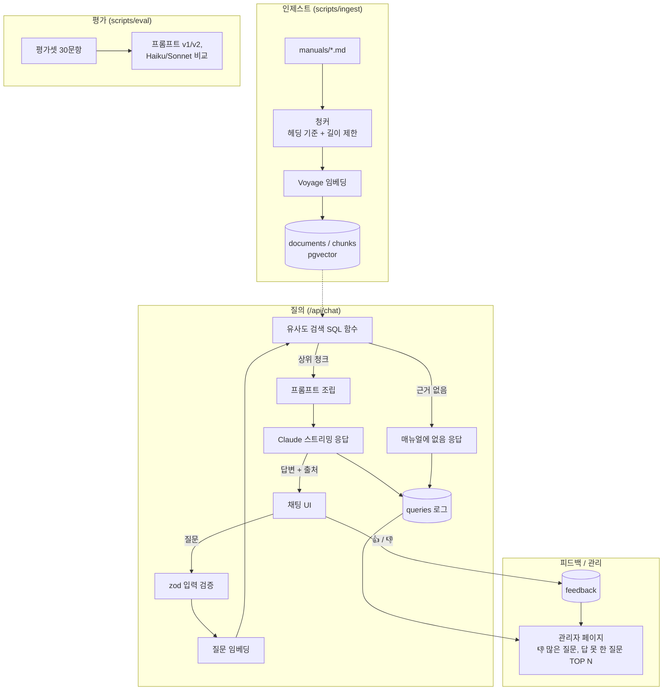

# CLAUDE.md

This file provides guidance to Claude Code (claude.ai/code) when working with code in this repository.

## 매장 업무 매뉴얼 RAG 챗봇

패스트푸드 매장 업무 매뉴얼을 지식베이스로 삼아 질문에 답하는 웹 챗봇.
일동홀딩스 AI 서비스 개발(신입) 지원용 포트폴리오다. 일정과 체크리스트는 `docs/PLAN.md`를 따른다.

---

## 1. 절대 규칙

### 작업 방식
나는 이 코드를 면접에서 직접 설명해야 한다. 그래서:
1. 코드를 쓰기 전에 접근 방식을 3줄 이내로 먼저 설명하고, 내가 확인하면 진행한다.
2. 한 번에 한 단계, 작은 단위로 작성한다. 여러 파일을 한꺼번에 만들지 않는다.
3. 작성 후에는 핵심 로직을 쉬운 말로 설명하고, 내가 직접 확인할 포인트(예외 처리, 보안, 데이터 정합성)를 짚어준다.
4. 내가 질문하면 코드 수정보다 설명을 먼저 한다.
5. 그날 작업이 끝나면 "오늘 만든 것을 2분 안에 설명하기" 질문을 3개 내준다.

### 금지 사항
- LangChain 등 RAG 프레임워크는 쓰지 않는다. 청킹·검색·프롬프트 조립은 직접 구현한다.
- API 키와 Supabase service role key는 서버에서만 쓴다. `NEXT_PUBLIC_` 접두사를 붙이지 않는다.
- 비밀 값은 `.env.local`에만 두고, `.env.example`에는 키 이름만 적는다.
- `.env*`(단, `.env.example`은 예외), `supabase/.temp/`, `supabase/.branches/`, `.vercel`, `drafts/`, `docs/study/`는 절대 커밋하지 않는다. 커밋 전에 `git status`로 올라갈 파일을 확인한다. 새로 무시할 파일이 생기면 `.gitignore`에 추가하자고 알려준다.
- 실수로 키가 커밋되면 파일 삭제로 끝내지 말고, 해당 키를 즉시 재발급해야 한다고 알려준다.
- 답변은 검색된 매뉴얼 근거로만 하고, 근거가 없으면 "매뉴얼에 없음"이라고 답한다. 답변에는 출처 문서를 표시한다.
- 실제 브랜드명, 로고, 사내 기밀 매뉴얼 내용은 넣지 않는다. 매뉴얼은 내 경험을 바탕으로 새로 쓴 일반 매장 기준이다.

---

## 2. 아키텍처

### 기술 스택
- Next.js 16.4.2 (App Router) + React 19.3.0 + TypeScript + Tailwind v4. `src/` 없이 루트에 `app/`, `lib/`를 둔다(경로 별칭 `@/*` → `./*`).
  - Next.js 16은 학습 데이터와 API가 다를 수 있다. App Router API는 코드를 쓰기 전에 `node_modules/next/dist/docs/`에서 확인한다(`AGENTS.md` 참고).
- Supabase: Postgres + pgvector
- LLM: Claude API (Anthropic SDK 직접 사용). 모델 ID: `claude-haiku-5-5`, `claude-sonnet-5-5` (3일차 비교 대상)
- 임베딩: Voyage `voyage-4`, 1024차원 (pgvector 컬럼은 `vector(1024)`). `input_type`은 인제스트 때 `document`, 질문 임베딩 때 `query`로 구분한다.
- 검증: zod(입력), Vitest(테스트)
- 배포: Vercel

### 폴더 구조 (계획, 구현하며 실제 경로로 갱신)
```
app/              페이지와 API 라우트 (/api/chat, /api/feedback, /admin)
lib/              청커, 임베딩, 검색, 프롬프트 조립, Supabase 클라이언트
scripts/          ingest, eval 스크립트
supabase/migrations/  스키마, RLS 정책, 유사도 검색 함수
manuals/          매뉴얼 마크다운 원본
docs/             PLAN.md
```

### 요청 흐름


### 설계 규칙
- 모든 API 입력은 zod로 검증한다.
- Supabase 테이블은 RLS를 켜고, 정책을 마이그레이션 파일로 관리한다.
- DB 변경은 SQL 마이그레이션으로 남긴다.
- 같은 문서를 다시 인제스트하면 기존 청크를 교체한다(문서 단위 upsert). 청크가 중복으로 쌓이면 안 된다.
- 관리자 페이지 집계는 직접 쓴 SQL로 한다.
- 단어 불일치 대응: 매뉴얼에는 표준 용어를 쓰고 다른 표현을 괄호로 병기한다(예: "프라이어(튀김기)"). 3일차 평가에서 다른 표현으로 묻는 질문의 점수가 낮으면 질문 변환(임베딩 전 용어집 적용)을 추가한다.

### 공부용 노트
개념 설명을 나중에 다시 볼 수 있게 저장해 달라고 하면 `docs/study/NN-주제.md`로 만든다. 끝에 스스로 점검할 질문을 붙인다. 이 폴더는 개인용이라 `.gitignore`에 있으므로, 커밋되는 문서(CLAUDE.md, 코드 주석 등)에서 참조하지 않는다.

---

## 3. 빌드 / 테스트

(`package.json` 기준. 스크립트를 추가하면 여기도 갱신한다)
- 개발 서버: `npm run dev`
- 프로덕션 빌드: `npm run build`
- 린트: `npm run lint`
- 전체 테스트: `npm test` (Vitest 4. Node 20에서 Vitest 5는 설치되지 않는다)
- 단일 테스트: `npx vitest run lib/chunk-markdown.test.ts`, 이름으로 거르기: `npx vitest run -t "코드 블록"`
- 인제스트: `TODO`
- 평가: `TODO`
- 배포: Vercel (GitHub 연결, `main` push 시 배포 예정)

---

## 4. 도메인 컨텍스트

### 업무 용어
매뉴얼, 평가셋, 프롬프트에서는 아래 표준 용어를 쓴다. 괄호 안은 사용자가 쓸 수 있는 다른 표현이다.
- **크루** (알바, 직원): 매장에서 근무하는 아르바이트 직원
- **매니저** (점장, 관리자): 시간대별 매장 운영을 책임지는 관리자
- **오픈 / 미들 / 마감** (오픈조, 마감조): 근무 시간대 구분. 오픈은 개점 준비, 마감은 폐점 정리
- **피크** (바쁜 시간, 러시): 주문이 몰리는 점심·저녁 시간대
- **홀딩 타임** (보관 시간): 조리된 제품을 판매할 수 있는 최대 보관 시간
- **폐기** (버리기): 홀딩 타임이나 유통기한이 지난 제품을 버리고 기록하는 것
- **선입선출** (FIFO): 먼저 들어온 재료를 먼저 쓰는 재고 원칙
- **해동** (녹이기): 냉동 재료를 정해진 시간 동안 냉장 상태로 옮겨 두는 것
- **프라이어** (튀김기): 튀김 조리 기기. 오일 교체와 청소 절차가 따로 있다
- **재고 실사** (재고 조사): 정해진 주기에 실제 재고 수량을 세어 기록과 맞추는 것

### 데이터 의미
- `documents`: 매뉴얼 문서 1개 = 1행. 출처 표시에 쓰는 제목을 가진다.
- `chunks`: 문서를 헤딩 기준으로 자른 조각과 임베딩 벡터
- `queries`: 사용자 질문, 검색 결과, 답변 여부 로그 (답 못 한 질문 집계에 사용)
- `feedback`: 답변별 👍/👎

### "근거 없음" 판단 기준
`TODO`: 유사도 임계값과 상위 k개 값 (3일차 평가로 조정, 바꾸면 여기에 기록)

---

## 5. 코딩 컨벤션

- 커밋 메시지: Conventional Commits + 한국어. 예: `feat: 헤딩 기준 청커 추가`, `fix: 검색 임계값 수정`
- 네이밍: 파일명 kebab-case(`chunk-markdown.ts`), 함수·변수 camelCase(`searchChunks`), React 컴포넌트 PascalCase(`ChatMessage.tsx`), DB 테이블·컬럼 snake_case(`chunks.document_id`)
- AI가 만든 코드에서 발견한 버그·보안 문제는 `VERIFICATION.md`에 날짜, 문제, 원인, 수정 내용으로 기록하자고 알려준다.
