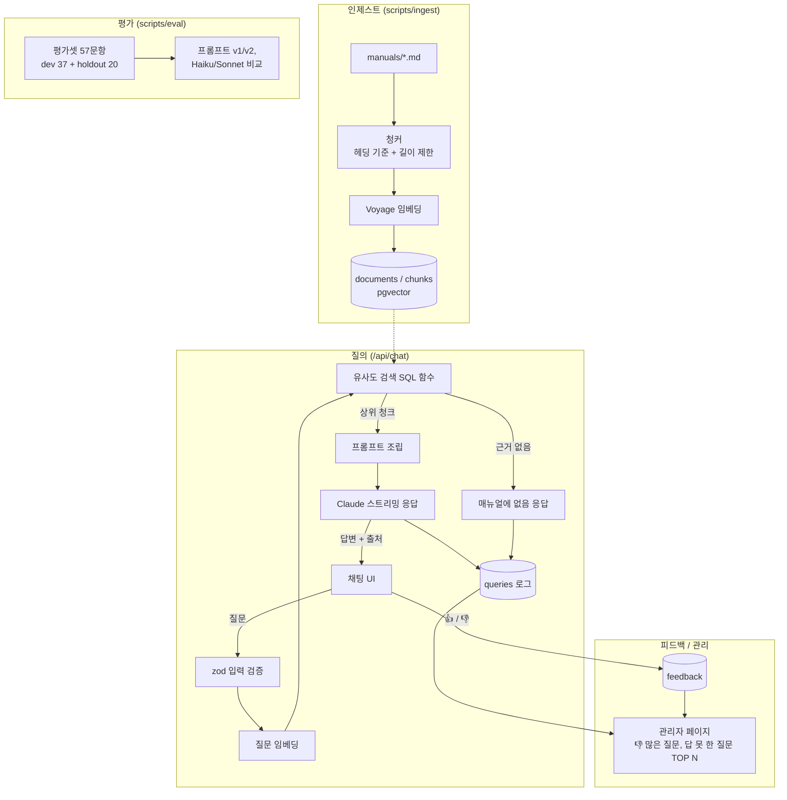

# CLAUDE.md

This file provides guidance to Claude Code (claude.ai/code) when working with code in this repository.

## 매장 업무 매뉴얼 RAG 챗봇

패스트푸드 매장 업무 매뉴얼을 지식베이스로 삼아 질문에 답하는 웹 챗봇.
일동홀딩스 AI 서비스 개발(신입) 지원용 포트폴리오다. 일정과 체크리스트는 `docs/PLAN.md`를 따른다.

---

## 1. 절대 규칙

### 작업 방식
나는 이 코드를 면접에서 직접 설명해야 한다. 그래서:
1. 코드를 쓰기 전에 접근 방식을 3줄 이내로 먼저 설명하고, 내가 확인하면 진행한다.
2. 한 번에 한 단계, 작은 단위로 작성한다. 여러 파일을 한꺼번에 만들지 않는다.
3. 작성 후에는 핵심 로직을 쉬운 말로 설명하고, 내가 직접 확인할 포인트(예외 처리, 보안, 데이터 정합성)를 짚어준다.
4. 내가 질문하면 코드 수정보다 설명을 먼저 한다.
5. 그날 작업이 끝나면 "오늘 만든 것을 2분 안에 설명하기" 질문을 3개 내준다.

### 금지 사항
- LangChain 등 RAG 프레임워크는 쓰지 않는다. 청킹·검색·프롬프트 조립은 직접 구현한다.
- API 키와 Supabase service role key는 서버에서만 쓴다. `NEXT_PUBLIC_` 접두사를 붙이지 않는다.
- 비밀 값은 `.env.local`에만 두고, `.env.example`에는 키 이름만 적는다.
- `.env*`(단, `.env.example`은 예외), `supabase/.temp/`, `supabase/.branches/`, `.vercel`, `drafts/`, `docs/study/`는 절대 커밋하지 않는다. 커밋 전에 `git status`로 올라갈 파일을 확인한다. 새로 무시할 파일이 생기면 `.gitignore`에 추가하자고 알려준다.
- 실수로 키가 커밋되면 파일 삭제로 끝내지 말고, 해당 키를 즉시 재발급해야 한다고 알려준다.
- 답변은 검색된 매뉴얼 근거로만 하고, 근거가 없으면 "매뉴얼에 없음"이라고 답한다. 답변에는 출처 문서를 표시한다.
- 실제 브랜드명, 로고, 사내 기밀 매뉴얼 내용은 넣지 않는다. 매뉴얼은 내 경험을 바탕으로 새로 쓴 일반 매장 기준이다.

---

## 2. 아키텍처

### 기술 스택
- Next.js 16.4.2 (App Router) + React 19.3.0 + TypeScript + Tailwind v4. `src/` 없이 루트에 `app/`, `lib/`를 둔다(경로 별칭 `@/*` → `./*`).
  - Next.js 16은 학습 데이터와 API가 다를 수 있다. App Router API는 코드를 쓰기 전에 `node_modules/next/dist/docs/`에서 확인한다(`AGENTS.md` 참고).
- Supabase: Postgres + pgvector
- LLM: Claude API (Anthropic SDK 직접 사용). 모델 ID: `claude-haiku-5-5`, `claude-sonnet-5-5` (3일차 비교 대상)
- 임베딩: Voyage `voyage-4`, 1024차원 (pgvector 컬럼은 `vector(1024)`). `input_type`은 인제스트 때 `document`, 질문 임베딩 때 `query`로 구분한다.
- 검증: zod(입력), Vitest(테스트)
- 배포: Vercel

### 폴더 구조 (구현하며 실제 경로로 갱신)
```
app/
  page.tsx              채팅 화면 (클라이언트 컴포넌트)
  ChatMessage.tsx       질문·답변·출처·👍/👎 한 쌍
  api/chat/route.ts     질문 → 검색 → 프롬프트 → Claude 스트리밍(NDJSON) → queries 저장
  api/feedback/route.ts 👍/👎 저장 (query_id 기준 upsert)
  admin/page.tsx        관리자 페이지 (👎 많은 질문, 답 못 한 질문 TOP 10, 요약 지표)
lib/
  chunk-markdown.ts     헤딩 기준 청커
  embed.ts              Voyage 임베딩
  search.ts             질문 임베딩 + search_chunks_expanded 호출
  build-prompt.ts       근거 번호 붙이기, 시스템 프롬프트(v1/v2), PROMPT_VERSION
  generate-answer.ts    Claude 답변 생성과 answered 판단 (/api/chat과 평가가 같이 씀)
  rate-limit.ts         요청 횟수 제한 (IP별 메모리 + 전체 사용량 DB)
  admin-auth.ts         /admin Basic 인증 검사 (proxy.ts와 admin.ts가 같이 씀, 환경 변수 없으면 항상 막음)
  admin.ts              관리자 데이터 접근: 인증 재확인 후 집계 SQL 함수 호출
proxy.ts                /admin 사전 인증 (Next 16에서 middleware가 proxy로 바뀜)
  chat-stream.ts        스트림 이벤트 타입과 NDJSON 읽기 (서버·브라우저 공용, 비밀 값 import 금지)
  supabase-server.ts    서버 전용 Supabase 클라이언트
scripts/
  ingest.ts             매뉴얼 → 청크 → 임베딩 → DB
  eval.ts               평가 (검색·답변 여부·답변 내용 채점)
  eval/cases.json       평가셋 57문항 (dev 37 + holdout 20)
  eval/results/         평가 결과 (<시각>-<모델>-<프롬프트>-k<검색 청크 수>d<확장 문서 수>.json)
supabase/migrations/    스키마, RLS·권한, 문서 교체 함수, 혼합 검색·문서 확장 함수, 관리자 집계 함수
manuals/                매뉴얼 마크다운 원본 (읽기 전용 444)
docs/                   PLAN.md
```

### 요청 흐름


### 설계 규칙
- 모든 API 입력은 zod로 검증한다.
- 요청 횟수 제한(`lib/rate-limit.ts`): IP별 1분 10회(질문·피드백 따로, 메모리라 최선 노력), 질문은 전체 1분 30회·24시간 500회(`queries` 기준, 조회 실패 시 통과). 순서는 입력 검증 → 제한 → 검색이다(검색부터 비용이 든다).
- Supabase 테이블은 RLS를 켜고, 정책을 마이그레이션 파일로 관리한다.
- DB 변경은 SQL 마이그레이션으로 남긴다.
- 같은 문서를 다시 인제스트하면 기존 청크를 교체한다(문서 단위 upsert). 청크가 중복으로 쌓이면 안 된다.
- 관리자 페이지 집계는 직접 쓴 SQL로 한다(`20261022035820_admin_dashboard_functions.sql`). 같은 질문은 `normalize_question`(공백 정리 + 소문자)으로 묶는다.
- 관리자 페이지는 `ADMIN_USERNAME`, `ADMIN_PASSWORD`(서버 전용)로 Basic 인증한다. proxy는 사전 확인이고, 데이터를 읽는 `lib/admin.ts`에서 다시 확인한다.
- 단어 불일치 대응: 매뉴얼에는 표준 용어를 쓰고 다른 표현을 괄호로 병기한다(예: "튀김기(프라이어)"). 병기는 문서마다 본문에서 처음 나올 때 한 번만 하고, 헤딩과 frontmatter에는 넣지 않는다. 3일차 평가에서 다른 표현으로 묻는 질문의 점수가 낮으면 질문 변환(임베딩 전 용어집 적용)을 추가한다.

### 공부용 노트
개념 설명을 나중에 다시 볼 수 있게 저장해 달라고 하면 `docs/study/NN-주제.md`로 만든다. 끝에 스스로 점검할 질문을 붙인다. 이 폴더는 개인용이라 `.gitignore`에 있으므로, 커밋되는 문서(CLAUDE.md, 코드 주석 등)에서 참조하지 않는다.

---

## 3. 빌드 / 테스트

(`package.json` 기준. 스크립트를 추가하면 여기도 갱신한다)
- 개발 서버: `npm run dev`
- 프로덕션 빌드: `npm run build`
- 린트: `npm run lint`
- Node 22 이상 (`package.json`의 `engines`). supabase-js 2.110+가 Node 22를 요구한다.
- 전체 테스트: `npm test` (Vitest 4)
- 단일 테스트: `npx vitest run lib/chunk-markdown.test.ts`, 이름으로 거르기: `npx vitest run -t "코드 블록"`
- 인제스트: `npm run ingest` (바뀐 문서만), `npm run ingest -- --force` (청커를 바꿨을 때 전체 재임베딩). 매뉴얼은 frontmatter에 `title`, `category`를 적는다.
- 평가: `npm run eval` (Haiku, 앱의 프롬프트 버전), `npm run eval -- --model sonnet`, `npm run eval -- --prompt v2`, `npm run eval -- --only a01,h15` (일부 문항, 결과 파일 저장 안 함)
  - 한 번에 약 $0.5 (57문항, 채점 Opus 5.5 포함). API 오류로 실패한 문항이 있으면 결과 파일 이름에 `-invalid`가 붙고 비교에 쓰지 않는다. 실행마다 점수가 0.03~0.06 흔들리므로 비교는 2회 이상 평균으로 한다.
  - holdout 문항은 개선을 설계할 때 보지 않은 문항이다. 결과를 보고 holdout 문항이나 그 내용을 프롬프트에 맞춰 고치지 않는다.
- 배포: Vercel (GitHub 연결, `main` push 시 배포 예정)

---

## 4. 도메인 컨텍스트

### 업무 용어
매뉴얼, 평가셋, 프롬프트에서는 아래 표준 용어를 쓴다. 괄호 안은 사용자가 쓸 수 있는 다른 표현이다.
- **직원** (크루, 알바): 매장에서 근무하는 아르바이트 직원
- **매니저** (점장, 관리자): 시간대별 매장 운영을 책임지는 관리자
- **오픈 / 미들 / 마감** (오픈조, 마감조): 근무 시간대 구분. 오픈은 개점 준비, 마감은 폐점 정리
- **바쁠 때** (피크, 바쁜 시간, 러시): 주문이 몰리는 점심·저녁 시간대
- **보관 시간** (홀딩 타임): 조리된 제품을 판매할 수 있는 최대 보관 시간
- **폐기** (버리기): 보관 시간이나 유통기한이 지난 제품을 버리고 기록하는 것
- **선입선출** (FIFO): 먼저 들어온 재료를 먼저 쓰는 재고 원칙
- **해동** (녹이기): 냉동 재료를 정해진 시간 동안 냉장 상태로 옮겨 두는 것
- **튀김기** (프라이어): 튀김 조리 기기. 기름(오일) 교체와 청소 절차가 따로 있다
- **재고 실사** (재고 조사): 정해진 주기에 실제 재고 수량을 세어 기록과 맞추는 것. 현재 매뉴얼에 해당 내용 없음

### 데이터 의미
- `documents`: 매뉴얼 문서 1개 = 1행. 출처 표시에 쓰는 제목을 가진다.
- `chunks`: 문서를 헤딩 기준으로 자른 조각과 임베딩 벡터
- `queries`: 사용자 질문, 검색 결과, 답변 여부 로그 (답 못 한 질문 집계에 사용)
  - `answered = false`는 세 경우가 섞여 있어 `answer`로 구분한다. 매뉴얼에 없음은 `answer = '매뉴얼에 없음'`, 모델 거절은 `answer`에 거절 안내가 포함되고, 오류·사용자 중단은 `answer is null`이다.
  - "답 못 한 질문" 집계는 `answered = false and answer is not null`로 한다. 오류나 중단까지 세면 매뉴얼에 있는 질문이 섞인다.
- `feedback`: 답변별 👍/👎

### "근거 없음" 판단 기준
현재 값 (2일차, 3일차 평가로 조정하고 바꾸면 여기에 기록):
- 검색: `search_chunks` (`supabase/migrations/20261018121212_hybrid_search_chunks.sql`). 벡터 검색과 키워드 검색(`pg_trgm` `word_similarity`)에서 후보를 20개씩 뽑아 RRF(k=60)로 합치고 상위 5개를 고른다.
- 문서 확장(k5d2): `search_chunks_expanded`가 위 5개 중 순위가 높은 문서 2개의 청크를 모두 더한다(`20261022031409_search_chunks_expanded.sql`). 3일차 평가에서 정답 문서는 찾았는데 필요한 청크가 13위 이하로 밀린 문항이 있었고, 청크 수를 늘리는 대신 문서 단위로 넓혀 청크 적중률이 0.875 → 1.0이 됐다(holdout 포함).
- 임계값은 벡터 유사도 바닥값 0.1뿐이고, 벡터·키워드 두 검색의 후보 모두에 적용한다(`20261018124220_search_chunks_keyword_floor.sql`). 명백히 무관한 청크만 거른다. 검색 결과가 0행이면 LLM을 부르지 않고 "매뉴얼에 없음"으로 답한다.
- 최종 판단은 프롬프트가 한다. 모델이 근거가 없다고 보면 `NO_ANSWER_MESSAGE`("매뉴얼에 없음")만 출력한다.
- `answered` 판단(`lib/generate-answer.ts`의 `isAnswered`): 거절이 아니고, "매뉴얼에 없음"으로 시작하지 않고, 발췌 번호 `[n]`을 하나 이상 인용했으면 답한 것으로 본다. 고정 문장만 보면 "매뉴얼 발췌에 ~ 내용은 없습니다" 같은 거절이 답한 것으로 기록됐다(3일차 평가).
- 모델: Haiku 5.5를 쓴다. Sonnet 5.5와 2회씩 비교해 점수는 같고(둘 다 1.0), Sonnet이 지연 중앙값 약 0.5초 느리고 답변 비용은 약 14배였다.
- 프롬프트: v1을 쓴다. v2(질문한 상황의 규칙만 쓰기, 핵심 답 먼저)는 3번 평가해 한 번도 v1보다 높지 않아 채택하지 않았다.
- 임계값만으로 판단하지 않는 이유: 1일차 실측에서 매뉴얼에 없는 질문("주차장 몇 대")의 1위 유사도(0.318)가 답이 있는 질문의 정답 유사도(0.267~0.287)보다 높았다. 혼합 검색을 적용한 뒤에도 0행이 되는 경우는 거의 없다.

---

## 5. 코딩 컨벤션

- 커밋 메시지: Conventional Commits + 한국어. 예: `feat: 헤딩 기준 청커 추가`, `fix: 검색 임계값 수정`
- 네이밍: 파일명 kebab-case(`chunk-markdown.ts`), 함수·변수 camelCase(`searchChunks`), React 컴포넌트 PascalCase(`ChatMessage.tsx`), DB 테이블·컬럼 snake_case(`chunks.document_id`)
- AI가 만든 코드에서 발견한 버그·보안 문제는 `VERIFICATION.md`에 날짜, 문제, 원인, 수정 내용으로 기록하자고 알려준다.
