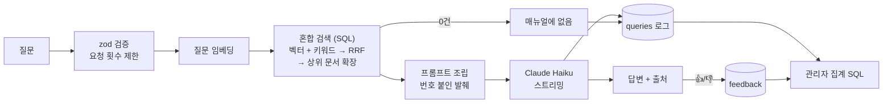

# 매장 업무 매뉴얼 RAG 챗봇

패스트푸드 매장 직원이 업무 중에 생기는 질문("튀김기 기름은 언제 갈아요?", "손님이 환불해 달라고 하면?")을 물으면, 매장 업무 매뉴얼을 근거로 출처와 함께 답하는 웹 챗봇입니다. 매뉴얼에 없는 내용은 지어내지 않고 "매뉴얼에 없음"이라고 답합니다.

- 데모: `TODO: 배포 후 URL`
- 데모 GIF: `TODO`

매뉴얼 19개는 매장 근무 경험을 바탕으로 새로 쓴 일반 매장 기준입니다. 실제 브랜드명이나 사내 매뉴얼 내용은 들어 있지 않습니다.

## 주요 기능

- **근거 기반 답변**: 검색된 매뉴얼 발췌만 근거로 답하고, 문장마다 `[1]`처럼 발췌 번호를 붙입니다. 답변 아래에는 인용된 출처("근태 > 지각할 것 같을 때")를 보여 줍니다.
- **"매뉴얼에 없음" 처리**: 근거가 없으면 답하지 않고, 일부만 있으면 있는 부분만 답한 뒤 없는 부분을 밝힙니다.
- **스트리밍 응답**: 답변이 생성되는 대로 화면에 나옵니다(NDJSON 스트림).
- **👍/👎 피드백과 질의 로그**: 모든 질문, 검색 결과, 답변 여부를 기록합니다.
- **관리자 페이지(`/admin`)**: 👎를 많이 받은 질문과 답 못 한 질문 TOP 10을 직접 쓴 SQL로 집계합니다. 자주 나오는 "답 못 한 질문"은 매뉴얼에 추가할 후보가 됩니다.
- **평가 스크립트**: 57문항으로 검색, 답변 여부, 답변 내용을 따로 채점해 프롬프트·모델·검색 설정을 숫자로 비교합니다.

## 기술 스택

| 영역 | 선택 | 이유 |
|---|---|---|
| 웹 | Next.js 16 (App Router), React 19, TypeScript, Tailwind v4 | 화면과 API를 한 프로젝트에서 만들고 Vercel에 바로 배포 |
| DB / 벡터 검색 | Supabase (Postgres + pgvector, pg_trgm) | 로그·피드백과 벡터를 한 DB에 두고, 검색과 집계를 SQL로 직접 작성 |
| LLM | Claude Haiku 5.5 (Anthropic SDK) | Sonnet 5.5와 평가 점수가 같고, 더 빠르고 답변 비용이 약 1/14 (아래 평가) |
| 임베딩 | Voyage `voyage-4` (1024차원) | 문서는 `document`, 질문은 `query`로 구분해 임베딩 |
| 검증 / 테스트 | zod, Vitest | 모든 API 입력 검증, 청커·프롬프트·판단 로직 단위 테스트 |

RAG 프레임워크(LangChain 등)는 쓰지 않았습니다. 청킹, 검색, 프롬프트 조립, 답변 판단을 모두 직접 구현해 각 단계의 동작을 설명하고 측정할 수 있게 했습니다.

## 요청 흐름



## RAG 설계에서 고민한 것

### 1. 벡터 검색만으로는 짧은 단어를 놓친다 → 벡터 + 키워드 혼합 검색
"알바가 지각하면?"을 벡터 검색만으로 찾으면 근태 문서가 5~9위였습니다. 그래서 `pg_trgm`의 `word_similarity`로 글자 조각이 겹치는 청크를 따로 뽑고, 두 결과를 **RRF(Reciprocal Rank Fusion)**로 합쳤습니다. 코사인 유사도와 trigram 점수는 단위가 달라 더할 수 없어서, 점수 대신 순위로 합칩니다(`supabase/migrations/20261018121212_hybrid_search_chunks.sql`).

### 2. 유사도 임계값만으로는 "매뉴얼에 없음"을 판단할 수 없다
매뉴얼에 없는 질문("주차장 몇 대")의 1위 유사도(0.318)가 답이 있는 질문의 정답 유사도(0.267~0.287)보다 높았습니다. 그래서 임계값은 명백히 무관한 청크만 거르는 낮은 바닥값(0.1)으로만 쓰고, 최종 판단은 프롬프트에 맡겼습니다.

### 3. 정답 문서는 찾는데 필요한 청크가 밀린다 → 문서 단위 확장 (small-to-big)
평가에서 정답 문서는 1~2위로 찾았지만, 답에 필요한 청크가 13위 이하로 밀린 문항이 있었습니다. 상위 k개를 늘리면 무관한 청크도 같이 늘어나기 때문에, 대신 **순위가 높은 문서 2개의 청크를 모두** 넣었습니다. 매뉴얼 문서가 1~2KB로 짧아서 가능한 선택입니다. 청크 적중률이 0.875에서 1.0이 됐고, 이 개선을 설계할 때 보지 않은 holdout 문항에서도 1.0이었습니다.

### 4. "답 못 함" 판단을 모델의 말투에 맡기지 않는다
처음에는 답변이 "매뉴얼에 없음"으로 시작하는지로 판단했습니다. 그런데 프롬프트를 바꾸자 모델이 "매뉴얼 발췌에 ~ 내용은 없습니다"처럼 올바르게 거절하면서도 고정 문장을 쓰지 않았고, 이 답이 "답함"으로 잘못 기록됐습니다. 지금은 **발췌 번호 인용이 하나도 없으면** 답하지 않은 것으로 봅니다(`lib/generate-answer.ts`의 `isAnswered`).

## 평가

`scripts/eval/cases.json`의 57문항(dev 37 + holdout 20)으로 평가합니다. 문항 유형은 다음과 같습니다.
- 답이 있는 질문
- 다른 표현으로 물은 질문(크루, 프라이어, 홀딩 타임, 오타·구어체)
- 부분 답변 질문
- 매뉴얼에 없는 질문(일부러 비슷한 주제를 고른 어려운 오답 포함)
- 프롬프트 인젝션

**holdout**은 개선을 설계할 때 보지 않은 문항입니다. 개선이 특정 문항에만 맞춰진 것인지 확인하려고 따로 채점합니다.

채점은 세 가지입니다.
- **검색**: 답에 필요한 청크가 들어왔는가 (코드)
- **답변 여부**: 답해야 할 때 답하고, 없을 때 "매뉴얼에 없음"이라고 했는가 (코드)
- **답변 내용**: 핵심 내용을 담았는가 (Claude Opus 5.5 채점, 맞음 1 / 일부 0.5 / 틀림 0)

| 단계 | 변경 | 전체 점수 | holdout | 청크 적중률 |
|---|---|---|---|---|
| 1 | 혼합 검색, 프롬프트 v1 (dev만) | 0.922 | - | 0.875 |
| 2 | + 상위 문서 2개 확장 | 0.962 ~ 0.990 | 0.925 ~ 0.975 | 1.0 |
| 3 | 프롬프트 v2 시도 | 0.923 ~ 0.981 | 0.875 ~ 0.975 | 1.0 |
| 4 | v1 유지, "답 못 함" 판단을 인용 기준으로 | 1.0 (2회) | 1.0 (2회) | 1.0 |

- **프롬프트 v2**("질문한 상황의 규칙만 쓰기", "핵심 답 먼저")는 3번 돌려 한 번도 v1보다 높지 않았고, "매뉴얼에 없음" 판단을 흔들어 채택하지 않았습니다.
- **Haiku 5.5 vs Sonnet 5.5**(각 2회): 점수는 둘 다 1.0입니다. 지연 중앙값은 1.6~1.7초 대 2.1~2.2초였고, 답변 비용은 Sonnet이 약 14배였습니다. 그래서 Haiku를 씁니다.
- 같은 설정도 실행마다 점수가 0.03~0.06 흔들려서, 비교는 2회 이상 평균으로 판단했습니다. 결과 파일은 `scripts/eval/results/`에 있습니다.
- 만점은 이 평가셋의 상한에 닿았다는 뜻이지, 모든 질문에 완벽하다는 뜻은 아닙니다.

## 보안

- **키는 서버에서만**: Supabase secret 키, Anthropic, Voyage 키는 서버 코드에서만 읽고 `NEXT_PUBLIC_`을 쓰지 않습니다. 빌드 결과물과 git 전체 이력에서 실제 키 값을 검색해 노출이 없음을 확인했습니다.
- **DB 접근**: 모든 테이블에 RLS를 켜고 공개 정책을 두지 않았습니다. 테이블과 SQL 함수는 `service_role`만 쓸 수 있습니다. 권한은 설정 화면이 아니라 DB에서 직접 조회해 확인합니다.
- **요청 횟수 제한**: IP별 1분 10회(메모리)와, 질문 전체 1분 30회·24시간 500회(DB 로그 기준)를 둡니다. 공개 URL에서 반복 호출로 API 크레딧이 바닥나는 것을 막는 상한입니다.
- **프롬프트 인젝션**: 질문과 발췌의 `<`를 이스케이프해 태그 경계를 지키고, 태그 안의 지시문을 따르지 않게 합니다. 시스템 프롬프트 유출, 발췌 위조, 인용 사칭, 외부 링크 삽입 등 8개 공격을 평가셋에 넣어 계속 확인합니다.
- **관리자 페이지**: HTTP Basic 인증을 proxy와 데이터 조회 직전에 두 번 확인합니다. 환경 변수가 없으면 항상 막습니다.
- **재인제스트**: 같은 문서를 다시 넣으면 한 트랜잭션에서 기존 청크를 지우고 새로 넣습니다. 두 번 다시 넣어도 청크 수가 같은 것을 확인했습니다.

AI가 작성한 코드에서 발견한 버그·보안 문제와 수정 내용은 [`VERIFICATION.md`](VERIFICATION.md)에 기록했습니다.

## 실행 방법

Node 22 이상이 필요합니다.

```bash
npm install
cp .env.example .env.local   # 값 채우기 (Supabase, Anthropic, Voyage, 관리자 계정)
npx supabase link            # Supabase 프로젝트 연결
npx supabase db push         # 스키마, 권한, 검색·집계 함수
npm run ingest               # manuals/*.md → 청크 → 임베딩 → DB
npm run dev                  # http://localhost:3000, 관리자는 /admin
```

| 명령 | 설명 |
|---|---|
| `npm test` | 단위 테스트 (Vitest) |
| `npm run eval` | 평가 (Haiku, 1회 약 $0.5) |
| `npm run eval -- --model sonnet` | Sonnet으로 같은 평가 |
| `npm run eval -- --prompt v2` | 프롬프트 버전 비교 |
| `npm run ingest -- --force` | 모든 문서 다시 임베딩 |

## 폴더 구조

```
app/                    채팅 화면, /api/chat, /api/feedback, /admin
lib/                    청커, 임베딩, 검색, 프롬프트, 답변 생성, 요청 제한, 관리자 인증
proxy.ts                /admin Basic 인증
scripts/                ingest, eval (평가셋과 결과 포함)
supabase/migrations/    스키마, RLS·권한, 검색·집계 SQL 함수
manuals/                매뉴얼 원본 19개
```

## 한계와 다음 단계

- **대화 맥락**: 질문 하나에 답 하나만 지원합니다. 이전 질문을 이어서 묻는 기능은 없습니다.
- **평가셋 상한**: 지금 평가셋은 만점에 닿아 더 좋은 설정을 구분하지 못합니다. 실제 사용 로그에서 👎와 "답 못 한 질문"을 모아 문항을 늘릴 계획입니다.
- **IP별 제한**: 서버리스 인스턴스마다 따로 세는 최선 노력 방식입니다. 트래픽이 늘면 Redis 같은 공유 저장소로 옮겨야 합니다.
- **매뉴얼 보강**: 관리자 페이지의 "답 못 한 질문"을 근거로 매뉴얼을 추가하고, 재인제스트 후 평가로 확인하는 흐름을 만들 예정입니다.
